# Solthera

## Project Overview

Solthera is a complete digital block implementation project that demonstrates the physical design flow of a processor subsystem from floorplan initialization through placement, clock tree synthesis, routing, congestion analysis, timing closure, and final signoff verification.

The project focuses on transforming a synthesized gate-level netlist into a timing-clean and routable physical layout while meeting setup and hold timing requirements. Throughout the implementation process, congestion hotspots, clock distribution quality, routing resources, and timing paths were analyzed and optimized until a clean post-route design was achieved.

Final implementation results show:

- Setup WNS: **+0.098 ns**
- Setup TNS: **0.000 ns**
- Hold WNS: **+0.010 ns**
- Hold TNS: **0.000 ns**
- Setup Violations: **0**
- Hold Violations: **0**
- Density: **46.875%**
- DRC-related routing constraints cleared
- Congestion hotspots removed after optimization

---

# Design Implementation Flow

The implementation flow followed the standard ASIC physical design methodology:

1. Floorplan Initialization
2. Placement and Pre-CTS Optimization
3. Early Global Routing
4. Congestion Analysis
5. RC Extraction
6. Pre-CTS Timing Analysis
7. Clock Tree Synthesis (CTS)
8. Post-CTS Timing Optimization
9. Clock Tree Debug Analysis
10. Detailed Routing
11. Post-Route Timing Analysis
12. Setup and Hold Optimization
13. Congestion Removal
14. Final Signoff Verification

---

# 1. Initial Floorplan

The design was initialized using the provided floorplan containing the processor subsystem and embedded memory macros. Core area utilization and macro placement were established before implementation began.

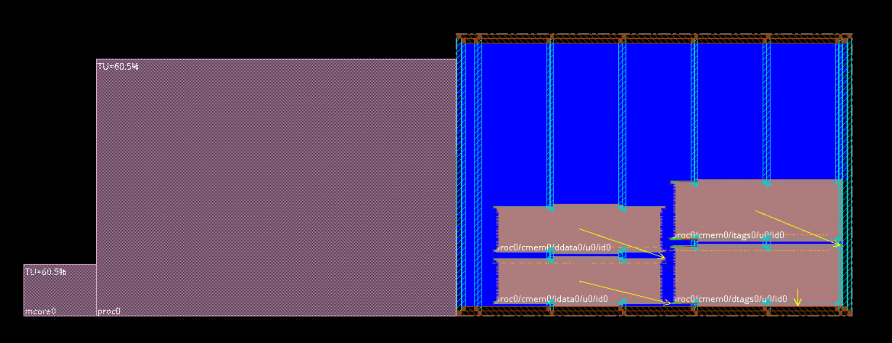

### Observations

- Memory macros are pre-placed.
- Power infrastructure is available.
- Routing channels are reserved between macros.
- Sufficient whitespace exists for standard-cell placement.

---

# 2. Floorplan and Macro Analysis

A detailed review of macro locations was performed to evaluate routing channels and placement accessibility.

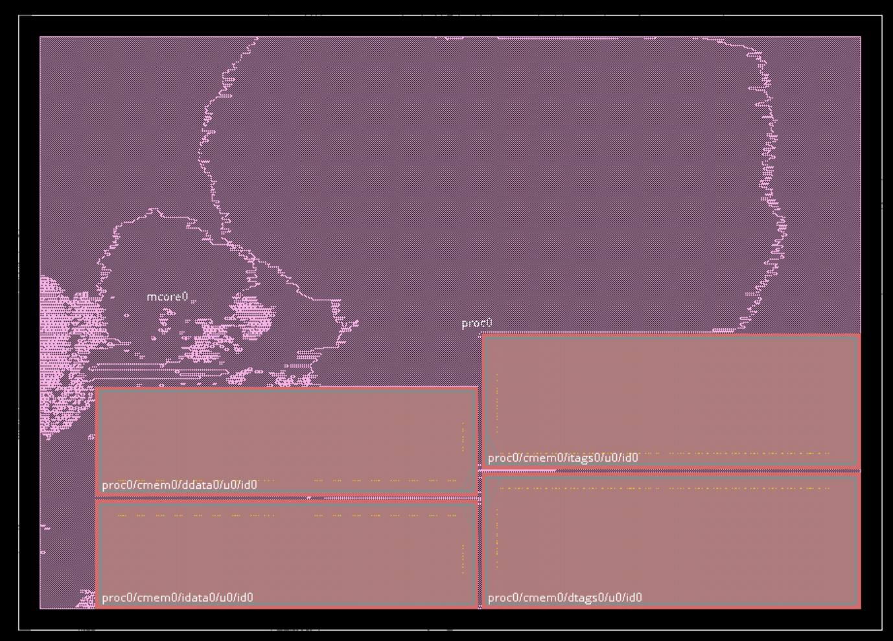

### Observations

- Four memory macros dominate the lower portion of the design.
- Routing corridors exist between macros.
- Macro placement significantly influences congestion behavior.

---

# 3. Placement Density Evaluation

The placement distribution was analyzed using the amoeba view to understand standard-cell clustering.

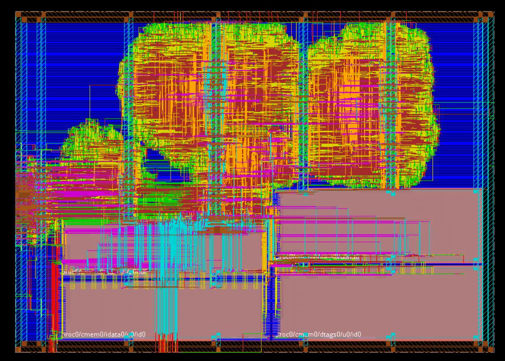

### Observations

- Logic is concentrated in upper regions.
- Dense placement regions correspond to critical processing logic.
- Lower regions are occupied primarily by memory structures.

---

# 4. Physical View After Placement

Following placement, standard cells were distributed across the core and interconnect planning became visible.

### Observations

- Standard-cell clusters formed around memory interfaces.
- Routing demand became concentrated in the center of the design.
- Placement quality appeared balanced with available routing resources.

---

# 5. Early Global Routing

Early Global Routing (EGR) was executed to estimate routing demand and identify congestion before detailed routing.

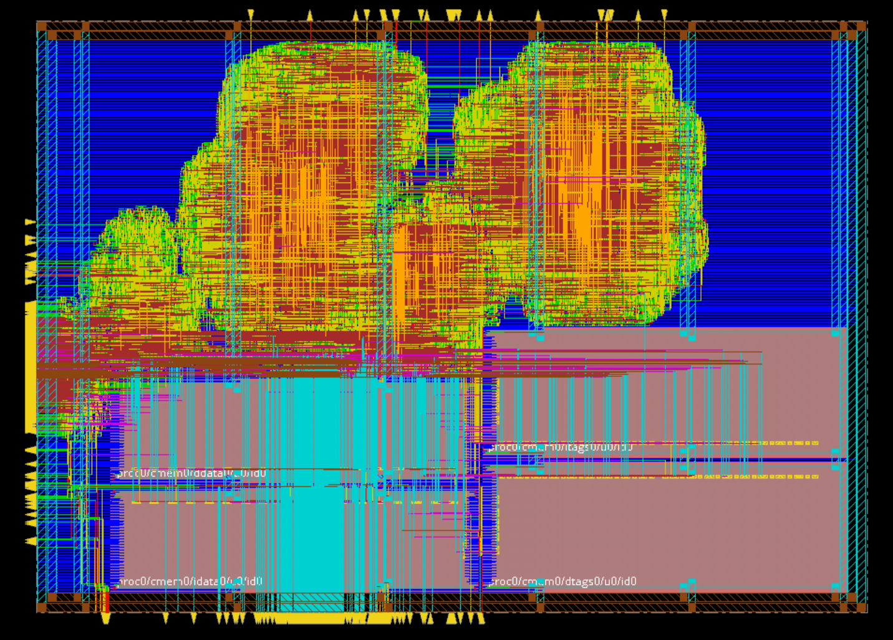

### Purpose

- Estimate routing resources.
- Predict congestion hotspots.
- Generate preliminary RC estimates.

---

# 6. Initial Congestion Analysis

Congestion analysis revealed severe routing bottlenecks in multiple regions.

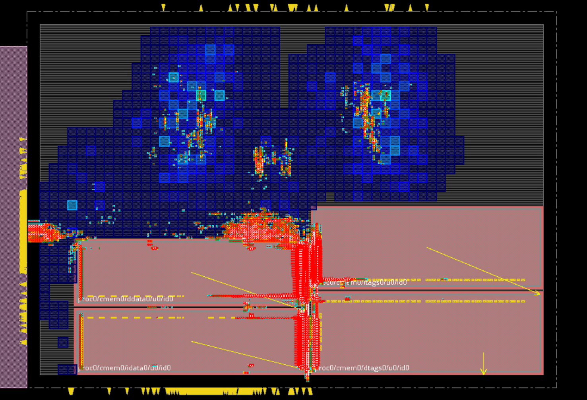

### Key Findings

- Heavy congestion near memory interfaces.
- Dense interconnect demand in central routing channels.
- Limited routing resources caused localized overflow.

---

# 7. Congestion Heatmap

A congestion heatmap was generated to identify routing pressure across the floorplan.

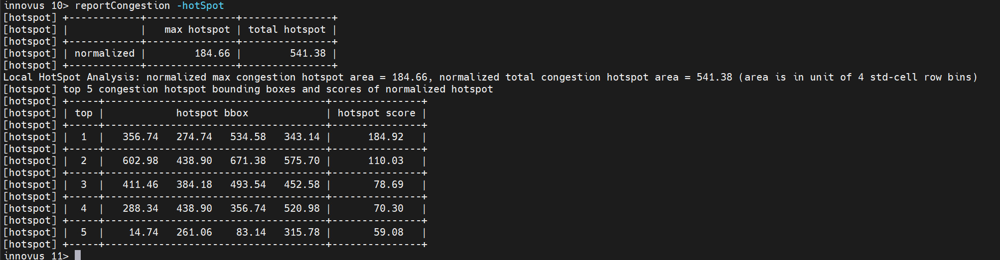

### Observations

- Hotspots appeared near macro boundaries.
- Vertical routing demand exceeded available resources.
- Congestion was concentrated around inter-macro communication paths.

---

# 8. Congestion Hotspot Report

Initial congestion measurements reported significant routing pressure.

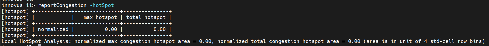

### Results

| Metric | Value |
|----------|----------|
| Max Hotspot | 184.66 |
| Total Hotspot | 541.38 |

These values indicated that routing optimization would be necessary before detailed routing.

---

# 9. Congestion Optimization

Routing resources were re-evaluated and optimization was performed to remove congestion bottlenecks.

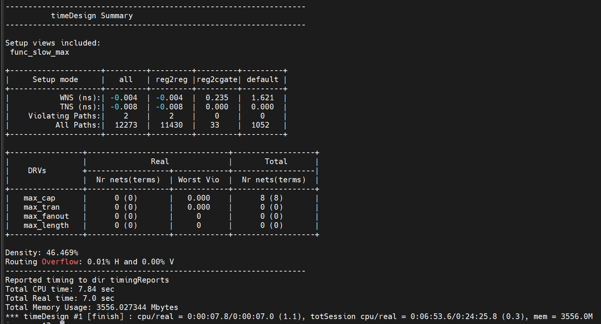

### Result

After optimization:

| Metric | Value |
|----------|----------|
| Max Hotspot | 0.00 |
| Total Hotspot | 0.00 |

The congestion hotspots were completely eliminated.

---

# 10. Pre-CTS Timing Analysis

Pre-CTS timing analysis was performed using ideal clocks.

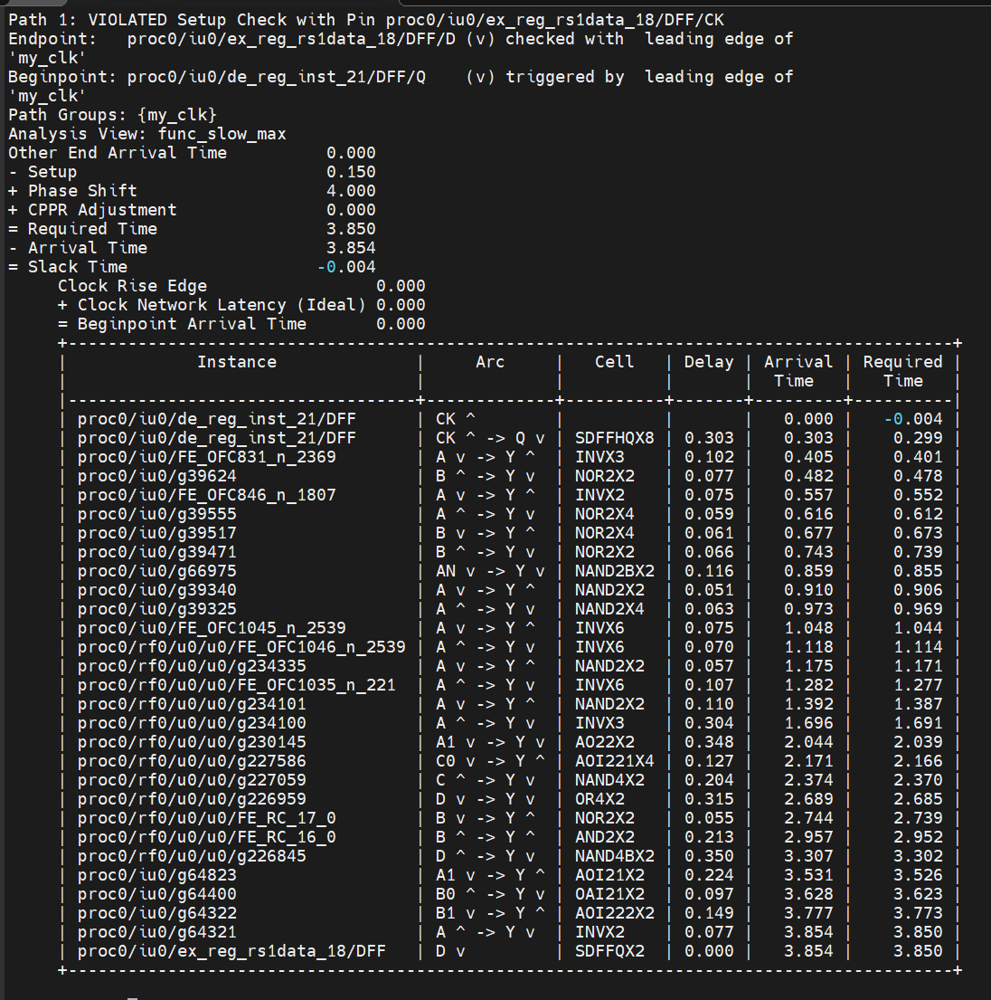

### Results

| Metric | Value |
|----------|----------|
| Setup WNS | -0.004 ns |
| Setup TNS | -0.008 ns |
| Violating Paths | 2 |

Only minor setup violations remained before clock tree synthesis.

---

# 11. Worst Timing Path Investigation

Critical timing paths were analyzed to identify sources of delay.

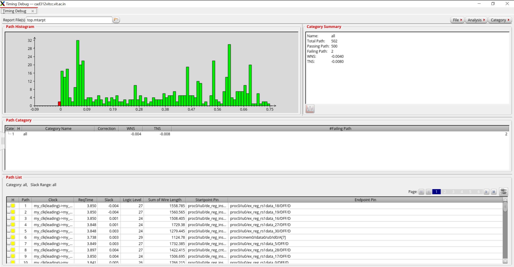

### Findings

- Long combinational paths existed between pipeline registers.
- Logic depth contributed to setup violations.
- Optimization targets were identified for subsequent stages.

---

# 12. Timing Distribution Analysis

A timing histogram was generated to evaluate slack distribution.

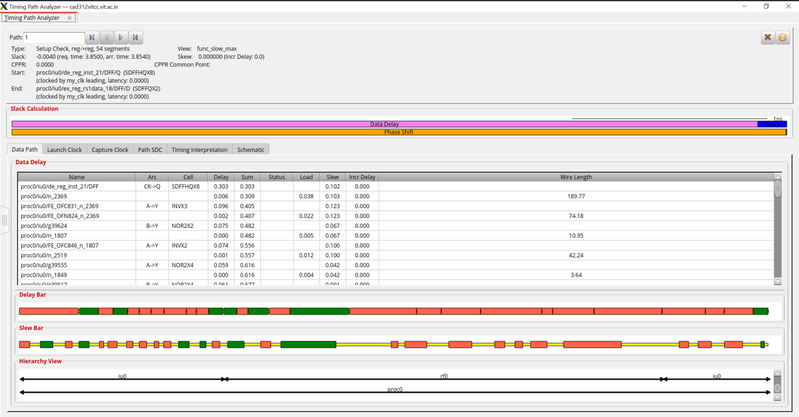

### Observations

- Majority of paths exhibited positive slack.
- Only two paths violated setup requirements.
- Timing closure was close prior to CTS.

---

# 13. Path-Level Timing Debug

Detailed path analysis was used to inspect delay contributions from cells and interconnect.

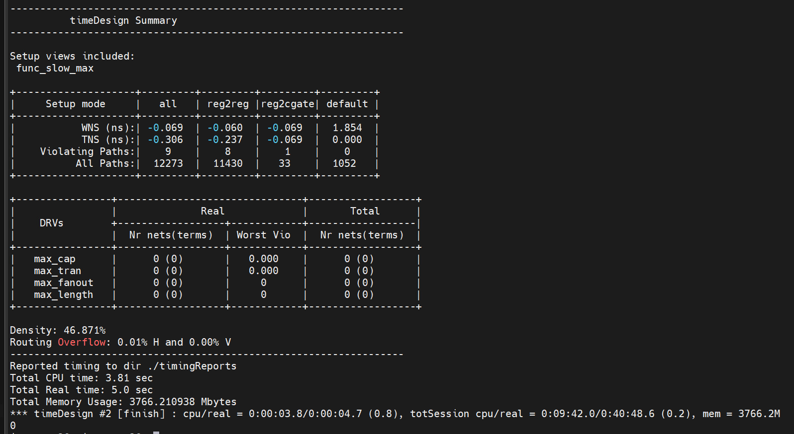

### Observations

- Data path delay dominated total path delay.
- Interconnect lengths significantly impacted critical paths.
- Optimization opportunities were identified.

---

# 14. Post-CTS Timing Analysis

Clock Tree Synthesis was performed and timing was re-evaluated.

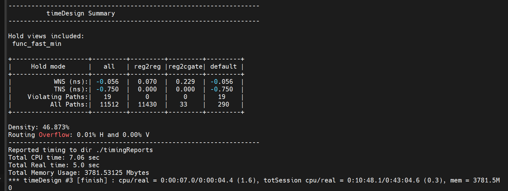

### Post-CTS Setup

| Metric | Value |
|----------|----------|
| WNS | -0.069 ns |
| TNS | -0.306 ns |
| Violations | 9 |

### Post-CTS Hold

| Metric | Value |
|----------|----------|
| WNS | -0.056 ns |
| TNS | -0.750 ns |
| Violations | 19 |

CTS introduced realistic clock delays and skew, exposing additional timing issues that required optimization.

---

# 15. Clock Tree Analysis

Clock distribution quality was inspected using the clock tree debugger.

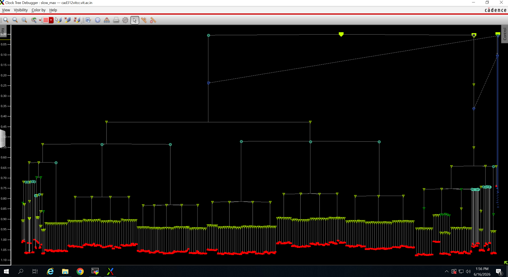

### Observations

- Balanced clock distribution achieved.
- Clock latency remained controlled.
- Skew characteristics were within expected limits.

---

# 16. Detailed Routing

Detailed routing connected all signal nets while considering timing and signal integrity objectives.

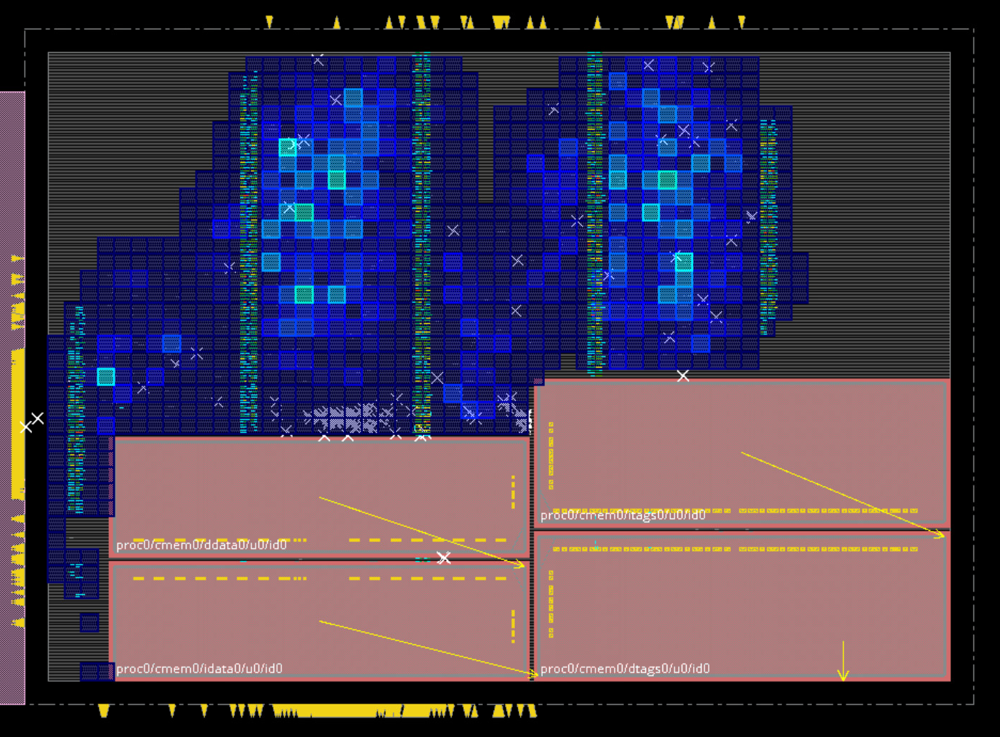

### Routing Features

- Timing-aware routing
- Signal integrity optimization
- Congestion-aware path selection
- Efficient layer utilization

---

# 17. Post-Route Timing Analysis

After detailed routing, timing was analyzed using extracted parasitics.

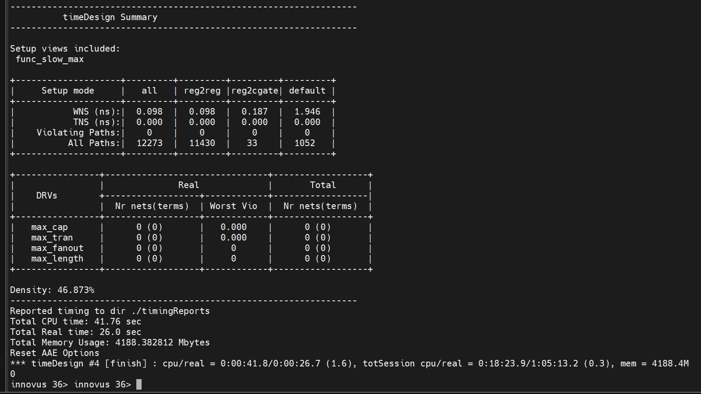

### Results

| Metric | Value |
|----------|----------|
| Setup WNS | -0.069 ns |
| Setup TNS | -0.306 ns |
| Violating Paths | 9 |

Routing parasitics introduced additional delay which required final optimization.

---

# 18. Post-Route Hold Analysis

Hold timing was evaluated after routing.

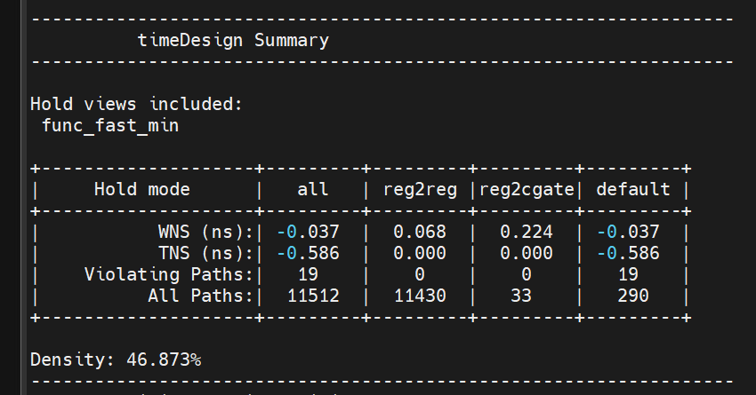

### Results

| Metric | Value |
|----------|----------|
| Hold WNS | -0.037 ns |
| Hold TNS | -0.586 ns |
| Violating Paths | 19 |

Hold fixing was subsequently performed.

---

# 19. Final Timing Optimization

Simultaneous setup and hold optimization was executed to close all remaining violations.

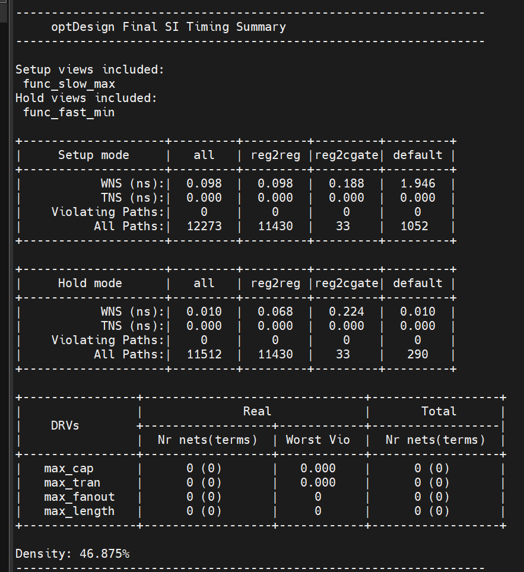

### Final Results

| Metric | Value |
|----------|----------|
| Setup WNS | +0.098 ns |
| Setup TNS | 0.000 ns |
| Hold WNS | +0.010 ns |
| Hold TNS | 0.000 ns |
| Setup Violations | 0 |
| Hold Violations | 0 |
| Density | 46.875% |

---

# Final QoR Summary

| Parameter | Final Value |
|------------|------------|
| Setup WNS | +0.098 ns |
| Setup TNS | 0.000 ns |
| Hold WNS | +0.010 ns |
| Hold TNS | 0.000 ns |
| Setup Violations | 0 |
| Hold Violations | 0 |
| Density | 46.875% |
| Congestion Hotspots | 0 |
| Max Cap Violations | 0 |
| Max Transition Violations | 0 |
| Max Fanout Violations | 0 |

---

# Conclusion

Solthera demonstrates a complete physical implementation flow for a processor subsystem. Starting from an initialized floorplan, the design progressed through placement, congestion analysis, timing optimization, clock tree synthesis, routing, and post-route closure. Congestion hotspots were eliminated, setup and hold timing violations were resolved, and the final design achieved positive timing margins with zero violations, resulting in a clean and implementation-ready physical layout.
